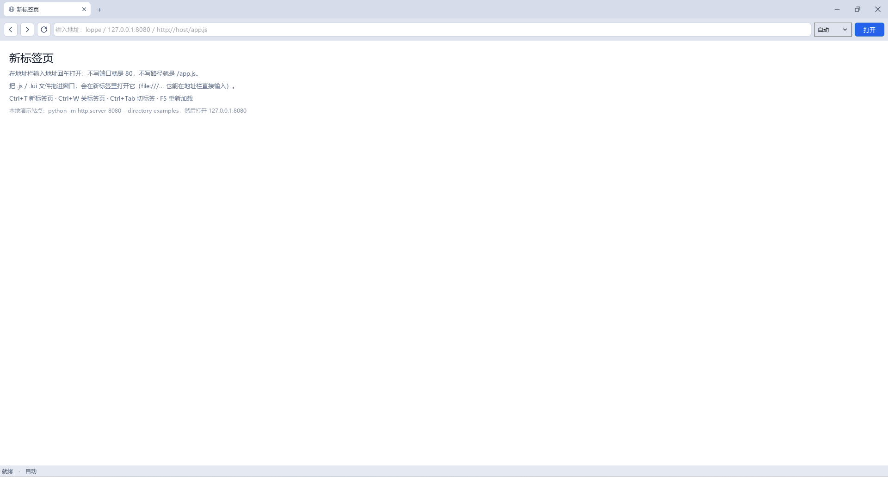

# loppe-browser

一个轻量的桌面浏览器：页面就是一段 JS 脚本，执行后直接产出界面。没有 Chromium，没有 HTML/CSS/DOM，
浏览器自己请求、自己解析地址、自己管权限。

## 为什么值得一试

- **小**：程序本体约 6 MB（单个可执行文件，引擎、字体、脚本引擎全部内置，不依赖任何运行时）。
- **省内存**：正常运行约 60 MB；渲染选 CPU 后端时约 30 MB。
- **写页面快**：用 JS + lui（一种直接描述界面的轻量文本格式）写页面，一个文件就是一整页，
  改完刷新就生效，没有构建步骤、没有打包流程。
- **多标签、真隔离**：每个标签是一套独立的界面和脚本环境，互不可见、互不干扰；后台标签照常运行，只是降频省电。
- **跨平台**：同一份内核，Windows / Linux（X11）/ Android / ESP32-S3 四个壳。
- **自带权限系统**：页面联网要先经过用户同意，授权按站点记录、跨次启动保留。

## 页面长什么样

`.lui` 用声明式写法描述布局和样式（面板、文字、图片、输入框、按钮……），JS 负责数据和交互：

- 界面格式 `.lui` 与逻辑脚本分离，也能在脚本里以组件方式拼装界面；
- 支持信号式响应更新（数据一变，界面只重画相关部分）、组件模板、事件绑定；
- 页面外观完全由页面自己决定，浏览器不附加默认样式 —— 仓库根的 `examples/` 里有几个可拖进窗口直接看的示例。

## 基本功能

| | |
|---|---|
| 标签页 | 多标签、切换、关闭，`Ctrl+T` / `Ctrl+W` / `Ctrl+Tab` |
| 地址栏 | 支持本地别名、IP/域名、端口与路径；不写端口是 80，不写路径是默认页 |
| 本地文件 | 把 `.js` / `.lui` 文件拖进窗口就在新标签打开，不联网；`F5` 重新读盘 |
| 快捷键 | `F5` 重新加载；双击标题栏最大化/还原 |
| 窗口 | 自绘无边框标题栏；Windows 保留系统拖动、贴边吸附、圆角阴影，Linux 由窗口管理器接管 |
| 权限 | 页面联网弹窗询问，允许/拒绝都记录在配置里，下次不再重复问 |

地址解析有三种模式（地址栏右侧下拉框）：自动（先查本地映射表再走 DNS）、仅域名、仅本地映射。
本地映射表就是一份文本配置（别名 = 主机:端口），每次导航都会重新读取，改完立即生效。

目前只支持明文 `http`（暂无 https）。

## 快速开始

1. 编译：`loppe-cli build . Debug --targets=LoppeBrowser`（引擎包已在仓库 `thirdparty/` 内，无需另装）；
   Linux 交叉编译加 `--os=linux`。
2. 运行 `build/Debug/LoppeBrowser.exe`，启动即是一个本地开始页，不联网。
3. 想看联网演示：`python -m http.server 8080 --directory examples` 起一个本地站点，
   地址栏输入 `127.0.0.1:8080`；或者在 `desktop/config/hosts.cfg` 里加一个别名（如 `loppe = 127.0.0.1:8080`），
   以后输别名就行。

## 仓库结构

| 目录 | 内容 |
|---|---|
| `kernel/` | 浏览器内核：标签与导航、脚本执行、网络与地址解析、权限 |
| `desktop/` | Windows / Linux 桌面壳（界面、窗口、配置） |
| `android/` | 安卓壳（界面仍是模板，待接入内核） |
| `esp32s3/` | ESP32-S3 壳（界面仍是模板，待接入内核） |
| `examples/` | 演示页面（可直接拖进窗口，或起本地站点访问） |
| `thirdparty/` | 引擎与脚本引擎的预编译包，按平台分目录，拿来即用 |
| `doc/` | 截图等文档资源 |

## 许可证

Apache License 2.0，见 [LICENSE](LICENSE)。第三方组件各自带自己的许可证：
`thirdparty/quickjs-ng/`（MIT）、以及引擎预编译包里的 FreeType / GLFW / glad
（FreeType 是 FTL/GPLv2 二选一，发布二进制时按 FreeType 的要求署名）。
